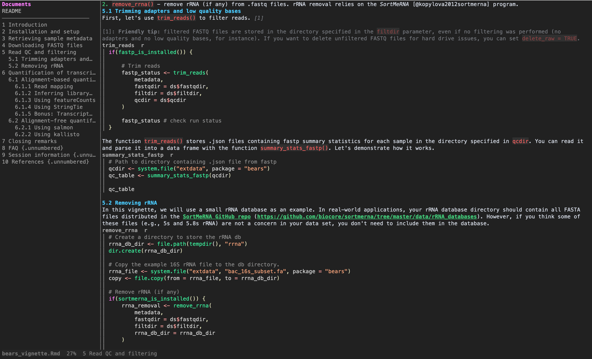

# rmdt

English | [中文](README.zh-CN.md)

Read R Markdown in the terminal, or write a page for a browser, without running
any code.

Knitting a vignette runs its code: installing packages, reading files, possibly
deleting things. `rmdt` skips all of that. It shows you the document, says which
chunks it did not run, and puts a caption and a placeholder where a figure would
have been drawn.



## Never runs your code

There is no execution path for document content. The only processes this program
ever starts are your `$EDITOR` (on the `e` key, so you can edit the line you are
reading) and the browser opener for `--html` (`open` on macOS, `xdg-open`
elsewhere). Both are guards in the test suite: the front end contains no
`Command::new` at all, and the only two call sites in the rest of the crate take
a literal or `$EDITOR`.

## Install

```sh
cargo build --release
ln -sf "$PWD/target/release/rmdt" ~/.local/bin/rmdt
```

## Use

```sh
rmdt ~/my_package
rmdt vignettes/intro.Rmd
rmdt --watch vignettes/intro.Rmd
rmdt ~/my_package --html
rmdt vignettes/intro.Rmd --md
rmdt vignettes/intro.Rmd --md | mdt
```

A bare `rmdt` walks up from the current directory to the nearest package (a
`DESCRIPTION` file or a `vignettes/` directory). A directory argument does the
same for that directory.

## A package becomes a site

Pointing `rmdt` at a package builds a small documentation site and then reads it
in the terminal:

```sh
cd ~/my_package
rmdt
rmdt --html
rmdt --html -d /tmp/site
```

The site goes to `<package>/.rmdview/` and the source tree is left alone. It
carries:

- an index with the package name, its `Title` and `Description` from
  `DESCRIPTION`, and its documents grouped into `Vignettes` and
  `Other documents`
- a navigation bar on every page, linking the package home page and every
  sibling document, so the pages read as one site rather than loose files
- each page's own floating contents and section numbering, from its front matter

Deep pages link with `../` as needed, and the test suite checks that every
relative link in a built site resolves to a file that exists.

The terminal view of a package lists the same documents in the same sections, so
`Enter` on the first entry opens the first vignette. `b` returns to the list.

The terminal view needs a terminal on both stdin and stdout. When it does not
have one, it says so and names the pages it wrote, rather than failing with a
terminal error:

```
$ rmdt ~/my_package | cat
site: 3 page(s) -> /home/me/my_package/.rmdview/index.html
rmdt: the terminal view needs a terminal on stdin and stdout. The pages are
already written: .../.rmdview/index.html. Use --html to write pages instead, or
run this in a terminal.
```

### Options

| Option | Effect |
| --- | --- |
| `--theme rmarkdown\|github\|plain` | the look of the written pages |
| `--tui-theme glow-dark\|glow-light\|minimal` | the look of the terminal: [glow](https://github.com/charmbracelet/glow)'s palette, for a dark or a light background, or `minimal` for the terminal's own colours |
| `--toc` / `--no-toc` | force the table of contents on or off |
| `--toc-depth N` | how deep the contents go |
| `--number-sections` / `--no-number-sections` | force section numbering |
| `--outline pinned\|popup\|off` | where the index column starts |
| `--watch` | read the file again whenever it changes |
| `--no-banner` | drop the "code not executed" strip from the page |
| `--no-math` | leave MathJax out of the page |
| `-o PATH`, `-d DIR` | where to write, for a file or for a directory |
| `--html` | write pages instead of reading in the terminal |
| `--md` | write the filtered Markdown to stdout, or to `-o` |
| `--open` | open the written page in a browser. Writing a page does not open one by itself |
| `--no-open` | state that nothing should be opened, which is the default |

Front matter is read first, so a document that already declares `toc: true`,
`toc_depth: 3` and `number_sections: yes` under `output:` gets those without any
flags. Flags win over front matter.

### Keys

| Key | Action |
| --- | --- |
| `j` `k` | one row |
| `←` `→` | move between the index column and the document |
| `↑` `↓` | move in whichever pane has the arrows |
| `Enter` | in the index: open that document, or enter that section |
| `d` `u`, space, page keys | one page |
| `h` `l` | half a page |
| `g` `G` | top, bottom |
| `[` `]` | previous, next section |
| `o`, tab | outline popup, `Enter` jumps |
| `t` | pin or unpin the outline column |
| `/` | search, `n` `N` for the next and previous hit |
| `e` | open the current source line in `$EDITOR` |
| `r` | read the file again |
| `b` | back to the file list |
| `?` | keys |
| `q`, `Ctrl-C` | quit |

A modal swallows the first key that closes it, so quitting from the outline
popup or the key list takes `Esc` then `q`.

### The terminal look

The colours are glow's: its markdown palette from glamour's style files, and its
code colours from the chroma tables those files carry. `glow-dark` and
`glow-light` differ only in which background they are painted for, and `minimal`
uses the terminal's own foreground with weight for headings, for a machine where
glow's fixed colours do not suit.

These are truecolour values. A terminal that only knows the 256 colour cube drops
a 24 bit request instead of erroring, which would leave a whole code block in the
default foreground, so every colour is rounded to the nearest number the terminal
has. On a 256 colour terminal the rounding lands on the numbers glow prints.

R chunks get the colours glow gives those tokens. Where syntect's R grammar reads
more than chroma's lexer does, the finer reading is kept: the name in
`f <- function(x)` is a function, `[` and `[[` are punctuation, and `...` takes
the colour its position gives it.

## What it does with chunks

| Chunk option | What you see |
| --- | --- |
| `echo=FALSE` | a one line note: `chunk name: code hidden (echo=FALSE)` |
| `include=FALSE` | nothing |
| `eval=FALSE` | the source, with a note that it was not evaluated |
| `child="other.Rmd"` | that document, inlined |
| `fig.cap="..."` | `Figure N: ...` under a placeholder where the figure would be |
| `#| echo: false` | read as well, for Quarto style documents |
| ```` ```{=html} ```` | passed through as raw HTML |

Inline R (`` `r nrow(df)` ``) is shown as an expression, never evaluated. In the
HTML output it keeps a `rinline` class so you can see which values the code would
have produced; the terminal shows it as a plain code span.

Markdown is parsed by `pulldown-cmark`, so CommonMark behaviour is the real
thing: lazy list continuation, tables, footnotes and alerts all work.

## How it is put together

```
.Rmd  ->  front end  ->  blocks with source lines  ->  terminal rows  ->  ratatui
                                                  ->  HTML page
```

The front end (`src/rmd.rs`) turns R Markdown into a list of blocks. Prose stays
as CommonMark so a markdown engine does the layout; headings, code, notes and
figures become their own blocks so both backends can render them their way and
the outline can point at them.

`src/render.rs` turns blocks into terminal rows one block at a time and keeps the
source line each row came from. That map is what the outline, the section jumps,
the position preserving reloads and the `e` key are built on. Since rows are
pre-wrapped, one row is always one screen row, and the scroll arithmetic stays
simple.

Rendering is done by [`tui-markdown`](https://github.com/joshka/tui-markdown)
(`pulldown-cmark` plus `syntect`), with a `StyleSheet` implementation as the
terminal theme. The HTML backend writes its own markup so the section numbers,
chunk headers, notes and figure captions land where they belong.

## License

MIT OR Apache-2.0.
